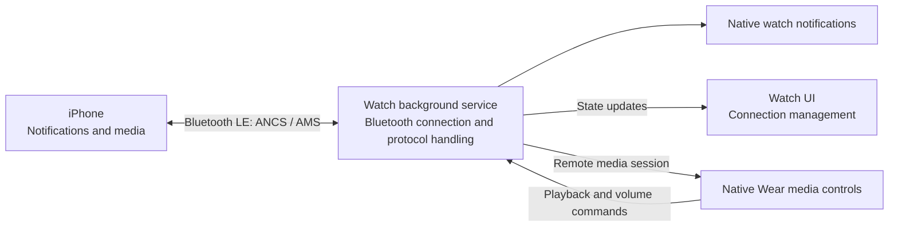

# Architecture

The app is a standalone Wear OS bridge between an iPhone and a Pixel Watch.
It connects directly over Bluetooth LE using Apple's Notification Center
Service (ANCS) and Media Service (AMS). No iPhone companion app or application
cloud backend is required.

## Responsibilities

- **Watch UI:** requests permissions, lets the user select a paired phone, and
  displays connection state and opens native media controls.
- **Background service:** owns the connection to the selected phone and keeps
  it active independently of the UI, using Android's connected-device
  foreground-service lifecycle.
- **Bluetooth and protocol handling:** discovers available services, subscribes
  to updates, serializes Bluetooth operations, and validates incoming data.
- **Notification and media handling:** turns phone events into native watch
  notifications and a remote Android media session, and sends supported playback
  and volume commands back to the phone.

These are responsibilities within one Android application, not separate
deployments.

## Data flow

**Notifications:** the iPhone reports an added, changed or removed notification.
The watch applies per-phone app filters before fetching content and mirrors
enabled notifications with cached app names. Blocking removes existing mirrors;
enabling does not replay old alerts.

iPhone-advertised action buttons send validated commands through the service.
Swiping dismisses only the watch copy; text replies are not supported.

**Media:** iPhone updates populate a service-owned remote media session and
media notification. Native controls send supported commands back to the phone;
state remains phone-reported. Audio stays on the iPhone. Native UI behavior
requires watch verification; artwork and arbitrary seeking are unavailable.

## Lifecycle and recovery

The user pairs the devices in system settings and explicitly selects the phone
in the app. The selection is saved; media state and pending work remain in
memory. The app does not scan for or switch to alternative phones.

The service reconnects after failures with capped exponential backoff and
suspends connection attempts while Bluetooth is off. Operations have timeouts,
queues and retained notifications are bounded, and missing media metadata gets
limited recovery attempts. Notifications or media can operate independently
when only one iPhone service is available.

Closing the UI does not stop the background connection. Closing a connection
clears pending work, media state and mirrored notifications. Android controls
background execution, so uninterrupted delivery is not guaranteed.

## Power use and boundaries

The design is event-driven: it subscribes to phone updates instead of polling,
requests only the data it uses, coalesces redundant work, and stops UI
observation when screens are inactive. There is no playback progress ticker,
application heartbeat or explicit wake-lock acquisition.

See [setup](README.md#setup) for platform prerequisites and
[Windows development](VSCODE.md) for build and test instructions.
